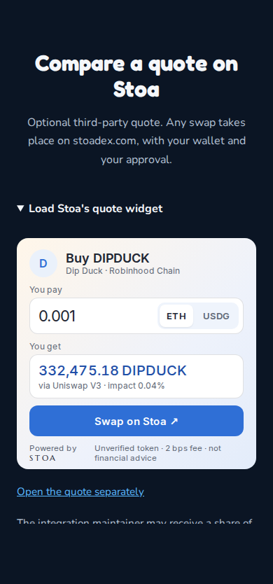

# Optional Stoa quote widget

The panel appears before the FAQ. Stoa is contacted only when the visitor opens it. It quotes DIPDUCK on Robinhood Chain; the swap link opens stoadex.com in a separate tab. This patch does not connect a wallet or sign a transaction.

The label, explanation, fallback link and referral disclosure are translated in English, French, Spanish and Chinese. The official widget itself uses Stoa’s interface.

## Referral and bounty

The iframe and fallback link use referrer `0x8c14cc5e5e5dd597fedb1107e598fedefac4b305`, controlled by the integration contributor. The referral disclosure is displayed under the widget. Stoa may share a portion of its own fee with that address.

This is a submission to [Stoa’s build bounty](https://stoadex.com/build), which offers 50 USDG for an eligible live token-site widget. Project agreement and publication on the token’s own site are required. Opening this pull request is not a bounty award or payment, and nothing is charged to Dip Duck for this patch. The project decides whether to approve and deploy it.

Stoa fixed an upstream eligibility-cache bug before this test: [StoaDex/Stoa#29](https://github.com/StoaDex/Stoa/issues/29#issuecomment-7062404998).

## Validation — 21 November 2026

- JavaScript syntax checks and `git diff --check` passed.
- Browser checked at widths 320, 390 and 1280 px. The widget adds no horizontal overflow; the original page has a pre-existing 1 px overflow.
- No request to Stoa occurs before opening the panel.
- All four translated sets display.
- The embedded live quote for 0.001 ETH returned 332,475.18 DIPDUCK via Uniswap V3 at test time; this is a changing quote, not a price guarantee.
- The swap link opened Stoa with the DIPDUCK address, Robinhood Chain, entered amount and contributor referrer intact.
- No wallet was connected, transaction signed, or swap submitted. This patch has not been deployed to dipduck.xyz.

To inspect locally, run `python3 -m http.server --directory public 8000`, open the page, switch languages, and expand the Stoa panel. Review the quote and separate-tab destination without connecting a wallet.

